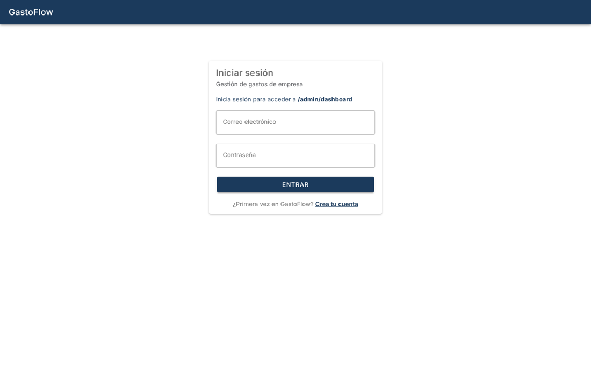
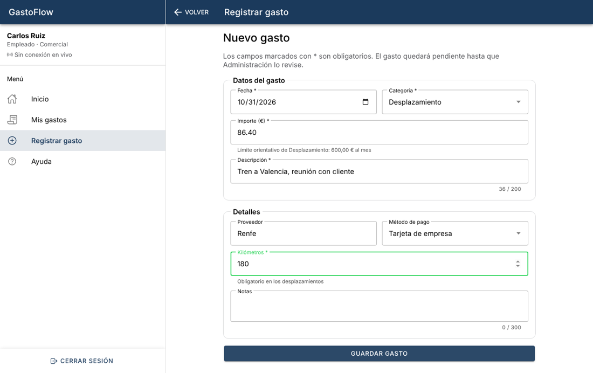
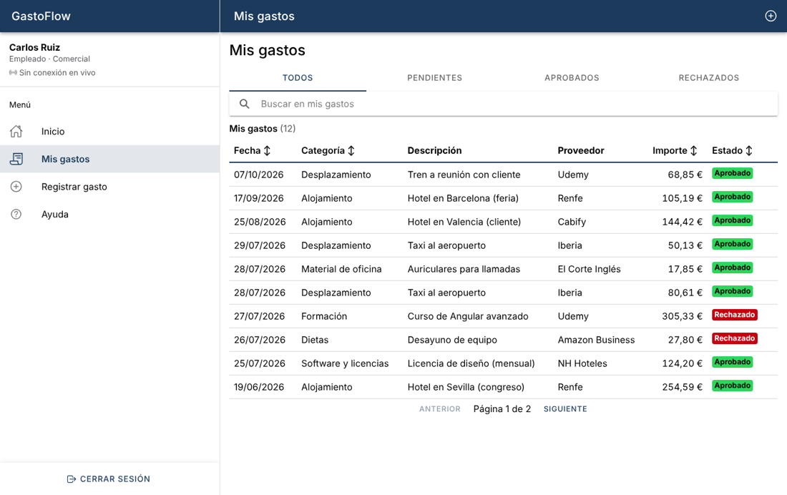
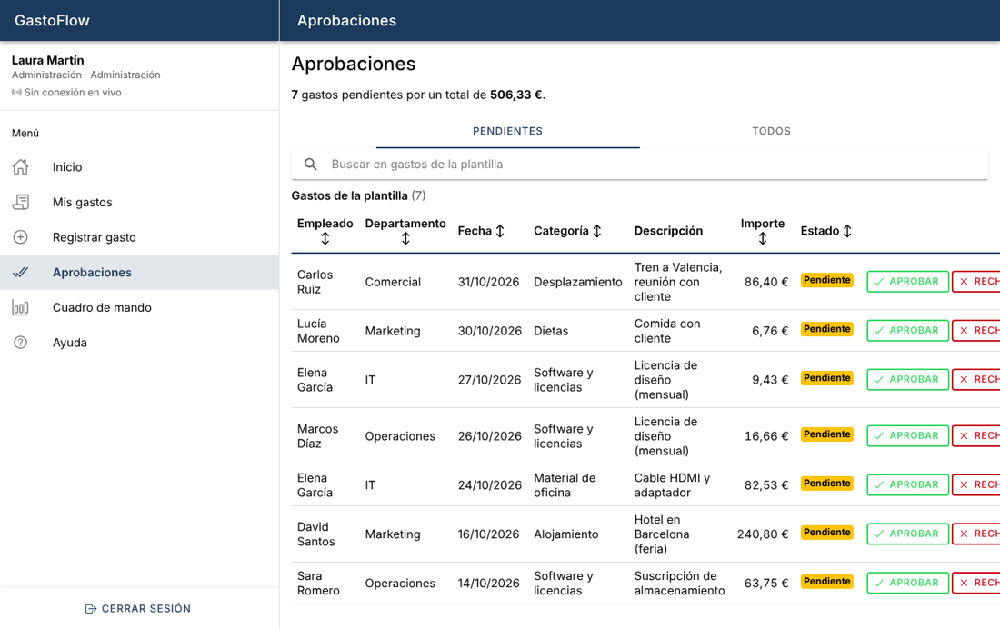
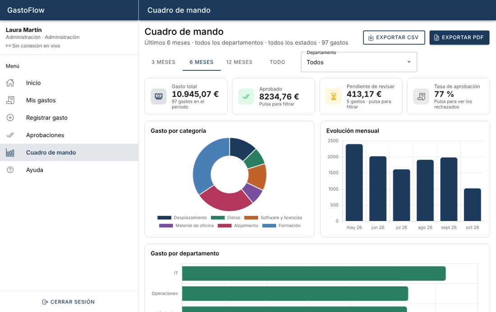

# Manual de usuario · GastoFlow

GastoFlow sirve para registrar los gastos de empresa (desplazamientos, dietas, material…) y que el equipo de Administración los revise. Funciona en el navegador del ordenador, en la tablet y en el móvil, y se puede instalar como aplicación (PWA).

> Este manual también está dentro de la app, en el menú **Ayuda**.

## 1. Acceso

- **Iniciar sesión:** escribe tu correo y tu contraseña y pulsa **Entrar**. Si intentas abrir una página privada sin sesión, la app te pide entrar y luego te lleva a la página que querías.
- **Crear cuenta:** en el login pulsa **Crea tu cuenta**.
  - La app comprueba **mientras escribes** que el correo no esté registrado.
  - La contraseña debe tener al menos 8 caracteres, con letras y números.
  - Las cuentas nuevas tienen el rol de **empleado**.
- **Cerrar sesión:** botón **Cerrar sesión**, al pie del menú lateral.

## 2. Empleado

### Inicio
Muestra un resumen de tus gastos (pendiente de revisar, aprobado este mes, rechazados y total) y botones rápidos para registrar un gasto o ver tu lista.

### Registrar un gasto
1. Menú → **Registrar gasto**.
2. Rellena la fecha (no puede ser futura), la categoría, el importe (hasta 5.000 €) y la descripción.
3. En **Detalles** puedes indicar el proveedor, el método de pago y notas. En los **desplazamientos** los kilómetros son obligatorios.
4. Pulsa **Guardar gasto**. Quedará **pendiente** hasta que Administración lo revise.

Si sales con el formulario a medias, la app te pregunta antes de perder los datos.

### Mis gastos
Lista de tus gastos con su estado (**Pendiente**, **Aprobado** o **Rechazado**).
- Filtra por estado con las pestañas superiores.
- Busca con el buscador: no distingue tildes ni mayúsculas.
- Ordena pulsando en la cabecera de una columna.
- Los gastos **pendientes** se pueden eliminar.
- Los cambios de estado llegan **en tiempo real**, sin recargar.

## 3. Administración

### Aprobaciones
Muestra los gastos pendientes de toda la plantilla.
- **Aprobar:** se aprueba al momento.
- **Rechazar:** pide un motivo (obligatorio), que el empleado verá.

La pestaña **Todos** muestra el histórico completo.

### Cuadro de mando
- **Filtros:** periodo (3, 6 o 12 meses, o todo) y departamento.
- **Indicadores:** gasto total, aprobado, pendiente y tasa de aprobación. Pulsa *Aprobado*, *Pendiente* o *Tasa de aprobación* para filtrar por ese estado; vuelve a pulsar para quitar el filtro.
- **Gráficos:** gasto por categoría, evolución mensual y gasto por departamento.
- **Exportar CSV** (se abre con Excel) y **Exportar PDF** (informe con resumen y tabla). Incluyen exactamente lo que estás viendo con los filtros actuales.

## 4. Accesibilidad

- Todo se usa con teclado: <kbd>Tab</kbd> / <kbd>Mayús</kbd>+<kbd>Tab</kbd> para moverse, <kbd>Enter</kbd> o <kbd>Espacio</kbd> para activar y <kbd>Esc</kbd> para cerrar.
- Los estados nunca se indican solo con color: siempre van con texto.
- Los gráficos tienen una descripción en texto para lectores de pantalla.
- La app respeta el zoom del navegador.

## 5. Preguntas frecuentes

- **No veo "Aprobaciones" en el menú.** Esas opciones son solo para el rol de Administración. Si escribes la dirección a mano, la app te devuelve al inicio con un aviso.
- **Mi sesión ha caducado.** La app renueva la sesión sola. Si no puede, te pide volver a entrar y después te devuelve a donde estabas.
